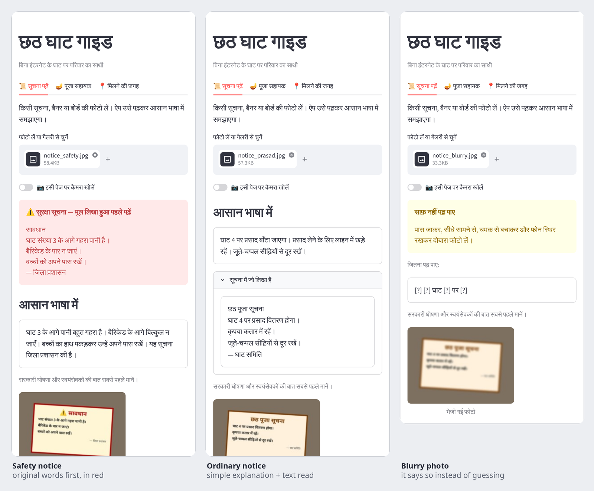
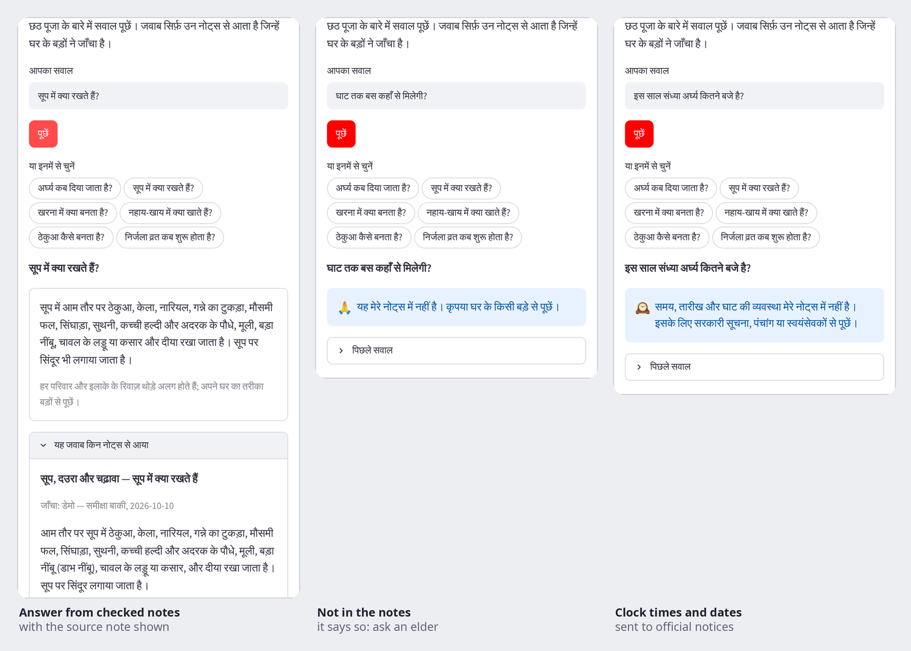
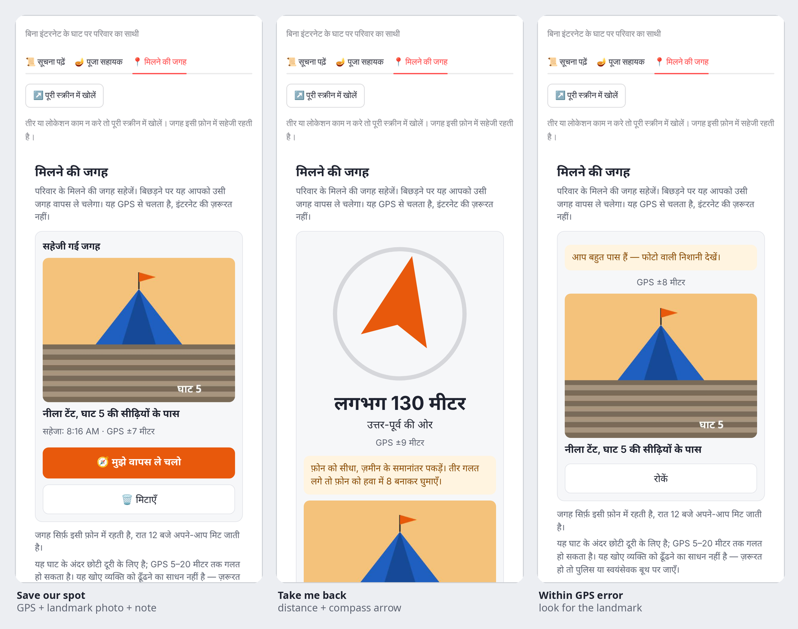
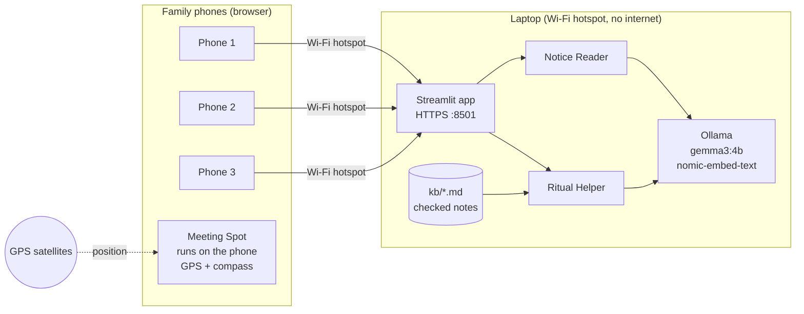

# 🌅 Chhath Ghat Guide

**An offline helper for families at crowded Chhath ghats.**
It reads notices from photos, answers ritual questions in Hindi, Bhojpuri or Maithili, and saves your family's meeting spot — all with **no internet**, because mobile networks jam when lakhs of people gather at the ghat.

> Built for the DEV **Hacktoberfest Open-Source AI Challenge — Week 1: "Touch Grass"**.
> The screen is a short helper; the experience is the ghat, the river and the family.

**Status (Oct 2026):** all three tabs are built and covered by automated tests (with a stand-in model and emulated GPS/compass). Still to do before the demo: the test with real Gemma on a laptop, an elder's review of the ritual notes, and a field test with mobile data off — see [plan.md](plan.md). The full test with a real crowd happens at Chhath Puja (late Oct / early Nov).

---

## Why

At big ghats, families get separated, notices are hard to read in the crowd, and calls and messages fail because the network is overloaded. Chhath Ghat Guide runs on a laptop at the ghat; family phones join the laptop's Wi-Fi hotspot (no internet needed) and open the app in a browser. GPS comes from satellites, not the mobile network, so the meeting-spot feature keeps working when calls don't.

## Features

| Tab | What it does | Status |
| --- | --- | --- |
| 📜 **सूचना पढ़ें — Notice Reader** | Take or upload a photo of a notice, banner or sign. A local Gemma vision model reads it and explains it in simple Hindi, Bhojpuri or Maithili. Always shows the text it read; says **"साफ़ नहीं पढ़ पाए"** when unsure. Safety notices (water depth, barricades, emergencies) show the original text first. | ✅ Built |
| 🪔 **पूजा सहायक — Ritual Helper** | Ask by text: *"अर्घ्य कब दिया जाता है?"*, *"सूप में क्या रखते हैं?"*. Answers come **only** from a small, family-checked knowledge base (Nahay-Khay, Kharna, Sandhya Arghya, Usha Arghya, offerings, fasting customs). If the answer isn't there, it says so and suggests asking an elder. Questions about clock times, dates or parking are sent to official notices. | ✅ Built — notes await elder review |
| 📍 **मिलने की जगह — Meeting Spot** | "Save our spot" stores GPS, a landmark photo and a note (e.g. *"blue tent near ghat 5 steps"*) on your phone. "Take me back" shows distance and an arrow using GPS and the phone compass — no map download. | ✅ Built |
| 🆘 **Emergency card** | Always visible: go to the nearest police or volunteer booth. Organisers can add verified local numbers; the app ships with **no** made-up numbers. | ✅ Built |
| ✨ Highlights, voice questions, spoken answers, shareable landmark description | | Later (P1) |

## Demo

- 🎥 **Video:** _coming after the field test_





_Real app screens on a phone-sized browser. The model text in the first two images is test data copied from the notices and notes (Gemma's own output will replace it after the field test); the Meeting Spot uses emulated GPS and compass._

## How it works



| Part | Choice |
| --- | --- |
| Model | Vision-capable **Gemma 3 4B** via [Ollama](https://ollama.com) (`gemma3:4b`) |
| App | Python + Streamlit, three tabs |
| Ritual answers | Small RAG over Markdown notes: keyword + `nomic-embed-text` embeddings |
| Location | Browser Geolocation + DeviceOrientation APIs; Haversine distance + bearing |
| Voice (P1) | `faster-whisper` |

More detail: [High-Level Design](docs/HLD.md) · [Low-Level Design](docs/LLD.md).

## Quick start (single laptop demo)

### 1. Requirements

- Python 3.10+
- [Ollama](https://ollama.com/download) installed
- ~4 GB free disk for models, ~8 GB RAM recommended
- A laptop camera or some notice photos to upload

### 2. Get the models (needs internet — do this **before** going to the ghat)

```bash
ollama pull gemma3:4b
ollama pull nomic-embed-text
```

### 3. Install and run

```bash
git clone https://github.com/ThePlator/Chhath_Ghat_Guide-.git
cd Chhath_Ghat_Guide-
python -m venv .venv
source .venv/bin/activate            # Windows: .venv\Scripts\activate
pip install -r requirements.txt

streamlit run app.py
```

Open **http://localhost:8501**. `localhost` counts as a secure context, so camera and location work in the laptop browser.

The Ritual tab stays off until the notes in `kb/` are checked by an elder (see [Ritual knowledge base](#ritual-knowledge-base)). After that, run `python scripts/build_index.py` once.

**First time with a new laptop or model?** Put a few notice photos in `tests/eval/notices/` and run `python scripts/spike_notice.py`. It reads each photo, explains it in Hindi, Bhojpuri and Maithili, times it, and writes a report to `tests/eval/notice_log.md`.

### 4. Check it is ready to go offline

```bash
python scripts/check_offline.py --deep
```

It checks models, ritual notes, that the phone pages load nothing from the internet, and more — each problem comes with the exact fix. Then switch Wi-Fi internet off and try all three tabs.

## Using it at the ghat (phones + laptop hotspot)

Phone browsers only allow GPS, camera and compass on **HTTPS**, so the app is served with a self-signed certificate.

1. **Turn on the laptop's hotspot** with internet sharing off. Note its IP:
   - Windows Mobile Hotspot: usually `192.168.137.1`
   - macOS Internet Sharing: usually `192.168.2.1`
   - Linux (NetworkManager): usually `10.42.0.1`
2. **Make a certificate** for that IP:
   ```bash
   scripts/make_cert.sh 192.168.137.1
   ```
3. **Enable HTTPS** — uncomment these lines in `.streamlit/config.toml`:
   ```toml
   sslCertFile = "certs/cert.pem"
   sslKeyFile  = "certs/key.pem"
   ```
4. **Check:** `python scripts/check_offline.py --hotspot-ip 192.168.137.1 --deep` should say *Ready for the ghat* (it also catches a certificate made for an old hotspot IP).
5. `streamlit run app.py`
6. On each phone: join the hotspot, open **`https://<laptop-ip>:8501`**, accept the certificate warning once, and allow location (and motion/compass on iPhone when asked).

For a field test, use the sheet in [docs/FIELD_TEST.md](docs/FIELD_TEST.md).

> **Tip:** once the Meeting Spot page has loaded on a phone, it keeps working even if the phone leaves the hotspot — everything for that tab runs on the phone.
> If the compass or location is blocked inside the tab, tap **"पूरी स्क्रीन में खोलें / Open full screen"**.

## Configuration

| File | What to change |
| --- | --- |
| `config/settings.toml` | Model names, image size, ritual match threshold (`min_score`), default language |
| `config/emergency.yaml` | Emergency message and **verified** local contacts (organisers fill this in on the day) |
| `.streamlit/config.toml` | Port, HTTPS certificate paths |
| `kb/*.md` | Ritual notes (see below) |

Swap the model by editing `vision_model` / `text_model` in `config/settings.toml` (any Ollama vision model works, e.g. a larger Gemma if your laptop can handle it).

## Ritual knowledge base

The Ritual Helper answers **only** from notes in `kb/`. Each note is written in our own words and checked by a family elder before use. The 10 notes in the repo are **drafts awaiting that review** — see [kb/README.md](kb/README.md) for how to check them.

```markdown
---
id: kharna
title_hi: खरना
day: 2
keywords: [खरना, kharna, खीर, गुड़, रोटी, शाम]
checked_by: "Nani (family elder)"
checked_on: 2026-10-10
---

## क्या होता है
...

## परिवारों में अंतर
...
```

Rules for contributors:

- Write in your own words; no copying from websites or books.
- **No fixed clock times or dates** — describe timings relative to sunrise / sunset. Real timings come from official notices.
- Customs vary by family and region — describe variations, never declare one "correct" way.
- A note without `checked_by` is ignored by the app.
- After editing notes, run `python scripts/build_index.py` (or just restart the app).
- To tune the match threshold with real models: `python tests/eval/run_ritual_eval.py --answer` (add `--include-unchecked` before the review). Target: no confident answers to the questions the notes can't answer.

## Safety, cultural care and privacy

**The app is a helper, never the authority.** Official announcements, police, ghat volunteers and family elders come first.

- Notices about water, barricades or emergencies always show the **original text**, never only a summary.
- The app never invents timings, ghat numbers or safety instructions; unclear text is flagged.
- Meeting Spot is for short distances inside one ghat. GPS is often off by 5–20 m near water and crowds — always look for the landmark photo and note too. **It is not a lost-person tracker.**
- **Nothing is uploaded.** Models run on the laptop; no analytics, no accounts.
- Photo metadata (including GPS in EXIF) is stripped before processing; notice photos are not saved to disk.
- Your meeting spot is stored only in your phone's browser, expires at midnight, and can be cleared with one tap.
- Please don't post photos of vratis who can be identified without their permission.

## Known limits

- **Bhojpuri and Maithili are beta.** Gemma's output in these languages may mix in Hindi; Hindi is the default.
- **Speed:** on a laptop CPU, reading a photo can take tens of seconds. One request is processed at a time; other phones wait their turn.
- **GPS accuracy** near crowds and water is limited; the compass needs calibration on some phones and is absent on laptops (you get text directions instead).
- **Self-signed certificate** warnings appear once per phone.
- **Not yet tested with real Gemma or in the field.** Automated tests use a stand-in model and emulated GPS/compass; the real-model and outdoor checks are the next steps. The full test with a real Chhath crowd is planned for Chhath Puja 2026.
- **Ritual notes are drafts** until an elder has checked them; until then the Ritual tab is off.
- The invented-number check compares separate numbers, so an explanation saying "5 बजे" can slip through if the notice mentions "घाट 5".

## Project structure

```text
app.py                      Streamlit entry point
ghat_guide/                 Python package
  llm.py                      the only module that talks to Ollama
  notice_reader.py, safety.py Notice Reader (transcribe → explain) and safety checks
  ritual/                     notes loader, embedding index, hybrid search, grounded answers
  ui/                         tabs, sidebar, emergency card
static/                     Meeting Spot widget (HTML + JS, runs on the phone) and its strings
kb/                         Ritual notes (Markdown; drafts until checked)
config/                     settings.toml, emergency.yaml
scripts/                    check_offline.py, make_cert.sh, build_index.py, spike_notice.py
tests/                      Unit and browser tests; tests/eval/ has the model evaluation sets
docs/                       HLD.md, LLD.md, FIELD_TEST.md, DEMO_VIDEO.md, DEV_POST.md
plan.md                     Build plan and status
```

## Development

```bash
pip install -r requirements.txt pytest
pytest                                  # no Ollama needed: the model is faked

# Optional: browser tests for the Meeting Spot widget (emulated GPS and compass)
pip install playwright && playwright install chromium
pytest tests/test_meeting_widget.py

# With Ollama and real models
python scripts/spike_notice.py          # notice reading quality and speed, per language
python tests/eval/run_ritual_eval.py --answer   # ritual answers; target 0 answers to out-of-notes questions
```

Contributions are welcome — especially checked ritual notes, Bhojpuri / Maithili translations of UI strings, and sample notice photos without identifiable people. Please open an issue first for larger changes.

## Why open innovation matters here

- Works with **no network** — exactly when it is needed most.
- **Data stays on the device**; nothing goes to a cloud service.
- **Free** to run on hardware a family already has.
- Speaks **local languages** that big apps often ignore.
- The model is open-weight and can be **swapped or fine-tuned** by anyone.

## Challenge

- DEV Hacktoberfest Open-Source AI Challenge, [Week 1: Touch Grass](https://dev.to/devteam/join-the-hacktoberfest-open-source-ai-challenge-week-1-touch-grass-2450-in-prizes-across-17-4pom)
- Prize category: **Best Use of Gemma**
- Tags: `#devchallenge #hf26challenge`

## License

[MIT](LICENSE)

---

*छठी मइया सबके मनोकामना पूरा करस। Built with care for the families at the ghat.*
