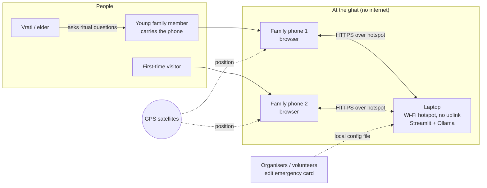
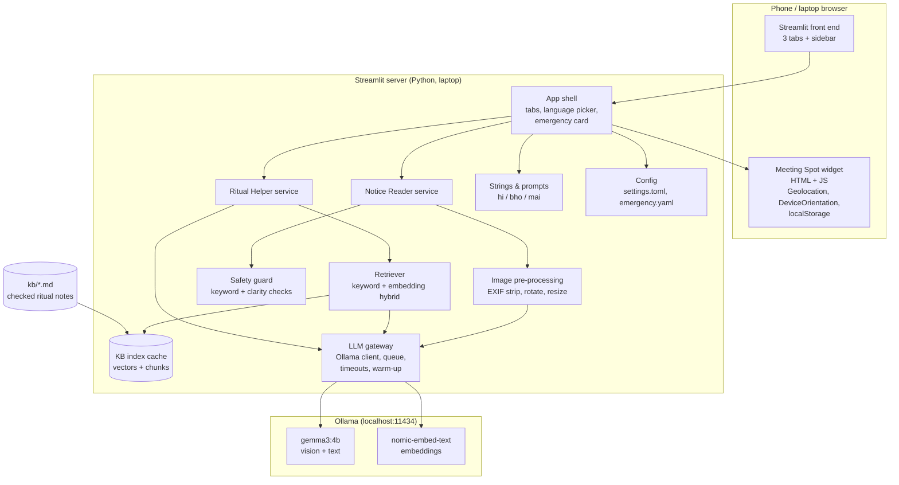
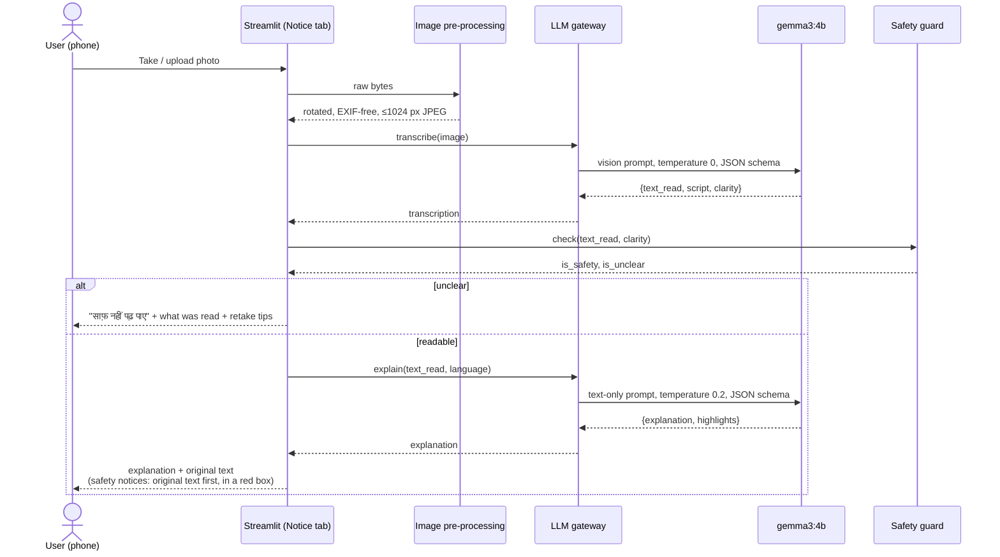
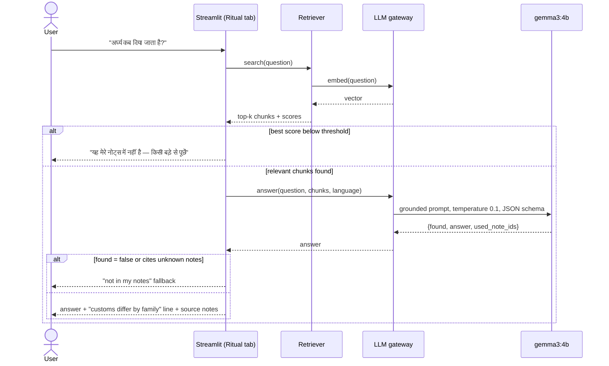
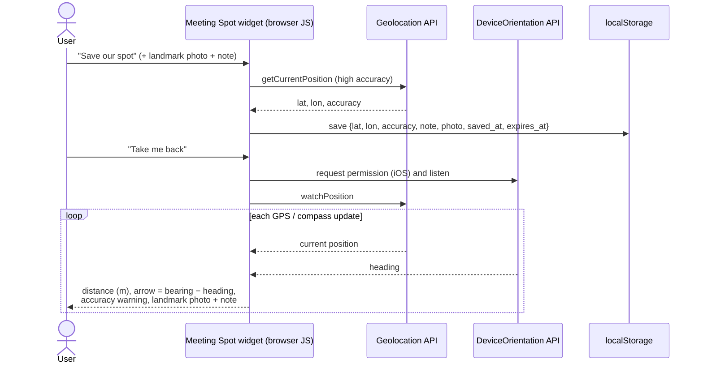
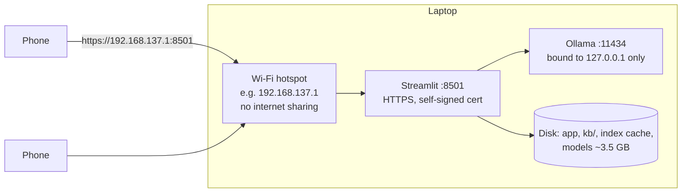

# Chhath Ghat Guide — High-Level Design (HLD)

| | |
| --- | --- |
| **Version** | 0.1 (draft) |
| **Date** | 10 Oct 2026 |
| **Author** | @Vn |
| **Source** | Chhath Ghat Guide PRD, 10 Oct 2026 |
| **Related** | [LLD](LLD.md) · [README](../README.md) |

---

## 1. Purpose and scope

This document describes the architecture of **Chhath Ghat Guide**, an offline helper for families at crowded Chhath ghats. It covers the system context, the main components, how data moves between them, the deployment at a ghat, and the key design decisions with their trade-offs.

It covers the three P0 features from the PRD and leaves room for the P1 items:

| Feature | P0 (must ship) | P1 (if time) |
| --- | --- | --- |
| **Notice Reader** (सूचना पढ़ें) | Photo → text read + simple explanation in Hindi / Bhojpuri / Maithili, "साफ़ नहीं पढ़ पाए" flag | Highlight times, ghat numbers, do / don't |
| **Ritual Helper** (पूजा सहायक) | Text question → answer only from a checked knowledge base, "not in my notes" fallback | Voice question (Whisper), spoken answer |
| **Meeting Spot** (मिलने की जगह) | Save GPS + landmark photo + note; "Take me back" distance + direction | Model-written landmark description to share |

**Out of scope** (PRD non-goals): live crowd tracking, lost-person search, contacting authorities, official timings for every ghat, native mobile apps.

## 2. Design goals and constraints

| # | Goal / constraint | Consequence for the design |
| --- | --- | --- |
| G1 | **Works with zero internet.** Mobile networks jam at the ghat. | All models run locally (Ollama). No CDN, fonts, map tiles or telemetry. Phones talk only to the laptop over its hotspot. |
| G2 | **Never invents ritual facts, timings or safety instructions.** | Ritual answers are retrieval-grounded with a hard "not found" path. Notice explanations are generated from the transcribed text only, and the original text is always shown. |
| G3 | **Local languages.** | Hindi is the default; Bhojpuri and Maithili are offered as "beta" until tested. All UI strings live in one translation table. |
| G4 | **Runs on an ordinary laptop CPU.** | Smallest vision Gemma (`gemma3:4b`), images resized to ~1024 px, model kept warm, one model request at a time. |
| G5 | **Privacy by default.** | No uploads anywhere. Meeting-spot data lives only in the phone's browser and expires at the end of the day. Photo EXIF (including GPS) is stripped before processing. |
| G6 | **Phone browser APIs need a secure context.** | Streamlit is served over HTTPS with a self-signed certificate on the hotspot, or over `http://localhost` on the laptop for the demo. |
| G7 | **Two-day build.** | One Python process, one framework (Streamlit), no database, no build step for front-end code. |

## 3. System context

- The **laptop** is the only server. It runs the Streamlit app and the Ollama model server and shares a Wi-Fi hotspot that has no internet uplink.
- **Phones** join the hotspot and open the app in a browser. GPS and compass are read on the phone, in the browser.
- The **demo mode** is a single laptop with its own camera and browser at `http://localhost:8501`.

## 4. Architecture overview

### 4.1 Components

| Component | Responsibility | Tech |
| --- | --- | --- |
| **App shell** | Page layout, three tabs, sidebar language picker (हिन्दी / भोजपुरी β / मैथिली β), always-visible Emergency card, "clear my data" button. | Streamlit `st.tabs`, `st.sidebar` |
| **Notice Reader service** | Takes a photo, gets a verbatim transcription, then a simple explanation in the chosen language. Decides clear / partly clear / unclear. Marks safety notices. | Python, Ollama vision call |
| **Image pre-processing** | Fixes rotation from EXIF, strips all metadata (photos carry GPS), resizes the long side to 1024 px, re-encodes as JPEG. | Pillow |
| **Safety guard** | Detects safety-critical notices (water depth, barricades, emergency, police, lost/found) from the transcription and forces the original text to be shown prominently. Flags unclear readings. | Keyword lists per language + model self-report |
| **Ritual Helper service** | Takes a text question, retrieves note chunks, asks the model to answer only from them, validates the answer, falls back to "not in my notes — please ask an elder". Shows the source notes. | Python, Ollama text call |
| **Retriever + KB index** | Loads `kb/*.md`, splits them by heading, builds embeddings once and caches them on disk; hybrid keyword + vector search with a minimum-score threshold. | `nomic-embed-text` via Ollama, NumPy |
| **LLM gateway** | Single place that talks to Ollama: model names, temperature, timeouts, JSON-schema outputs, `keep_alive`, a process-wide lock so phones queue instead of overloading the CPU, warm-up on start. | `ollama` Python client |
| **Meeting Spot widget** | Runs entirely in the browser: saves GPS fix + landmark photo (downscaled) + note to `localStorage`, then shows distance and an arrow to the saved spot using GPS and the compass. Expires at midnight; one-tap clear. Never sent to the server. | Plain HTML/JS, embedded with `st.components.v1.html` and also served as a full-page static file |
| **Strings & prompts** | All UI text and prompt templates for each language in one place. | Python dicts / TOML |
| **Config** | Model names, thresholds, image size, HTTPS paths; organiser-editable emergency card (ships empty of phone numbers). | `config/settings.toml`, `config/emergency.yaml` |

## 5. Key flows

### 5.1 Notice Reader

**Why two model calls instead of one:** the explanation is produced only from the text the model says it read, so every claim in the explanation can be checked against the text shown to the user. The second call is text-only and much cheaper than the image call.

### 5.2 Ritual Helper

### 5.3 Meeting Spot

The server is never involved after the page loads, so this keeps working even if the laptop is switched off once the page is open.

## 6. Deployment view

| Mode | URL | Notes |
| --- | --- | --- |
| **Demo (single laptop)** | `http://localhost:8501` | `localhost` counts as a secure context, so GPS, camera and compass APIs are allowed (laptop compass is usually absent; the widget falls back to text directions). |
| **Ghat (hotspot)** | `https://<laptop-hotspot-ip>:8501` | Self-signed certificate whose SAN contains the hotspot IP. Each phone accepts the warning once. |

- Ollama listens on `127.0.0.1` only; phones can never reach the model directly.
- No process makes outbound calls. Streamlit's usage statistics are switched off (`browser.gatherUsageStats = false`).
- Models must be pulled **before** going to the ghat (`ollama pull gemma3:4b`, `ollama pull nomic-embed-text`).

**Rough sizing (to confirm on Saturday's test):** `gemma3:4b` ≈ 3.3 GB on disk and needs ~6 GB RAM; on a modern laptop CPU expect tens of seconds per photo. One request runs at a time; other phones see "your turn is coming". A family group (2–5 phones) is the design target, not a whole ghat.

## 7. Data design

| Data | Where it lives | Lifetime | Sent over the hotspot? |
| --- | --- | --- | --- |
| Notice photo | Server memory (Streamlit session) | Until the tab is closed / next photo; never written to disk | Phone → laptop, once |
| Transcription + explanation | Server memory (session) | Same as above | Laptop → phone |
| Ritual question / answer | Server memory (session) | Same as above | Yes |
| Ritual notes `kb/*.md` | Laptop disk, in the repo | Permanent, version-controlled | Excerpts only, as sources |
| KB index (chunks + vectors) | `data/kb_index.npz` + `.json` on laptop | Rebuilt when any note changes (content hash) | No |
| Meeting spot (GPS, photo, note) | Phone `localStorage` | Until midnight local time, or "clear" tap | **Never** |
| Emergency card | `config/emergency.yaml` on laptop | Edited by organisers | Rendered text only |
| Logs | stdout only; no question text, no images, no coordinates | Process lifetime | No |

## 8. Cross-cutting concerns

### 8.1 Safety

- **Original text always shown.** The text read from the notice is always visible; for safety notices it is shown first, in a highlighted box, above the explanation.
- **No invented facts.** Prompts forbid adding times, ghat numbers or instructions not present in the source. A post-check compares numbers in the explanation with numbers in the transcription and flags any that do not appear there.
- **Unclear is a first-class result**, not an error: low model-reported clarity, very short text, or many `[?]` markers → "साफ़ नहीं पढ़ पाए" with tips (move closer, avoid glare, hold steady).
- **Emergency card** in the sidebar on every screen: "Go to the nearest police or volunteer booth"; organisers can add local numbers in `config/emergency.yaml`. The repo ships with **no** phone numbers.
- **Meeting Spot disclaimer:** for short distances inside one ghat; GPS can be off by 5–20 m; not a lost-person tracker.

### 8.2 Cultural care

- Ritual notes are written in the author's own words and each note records who checked it and when (`checked_by`, `checked_on` front matter). Unchecked notes are not indexed.
- Every ritual answer ends with a short line that customs vary by family and region.
- Respectful tone set in the system prompt; no humour.

### 8.3 Privacy

- No accounts, no analytics, no external calls.
- EXIF (including GPS in photos) stripped before any processing.
- Meeting-spot data never leaves the phone and auto-expires; one-tap clear.
- Server keeps nothing between sessions.

### 8.4 Performance

- `keep_alive` keeps `gemma3:4b` loaded for 30 minutes; a warm-up call runs when the app starts.
- Images capped at 1024 px on the long side.
- KB embeddings computed once and cached; only the question is embedded at query time.
- A process-wide lock serialises model calls so concurrent phones don't thrash the CPU.

### 8.5 Availability and failure handling

| Failure | Behaviour |
| --- | --- |
| Ollama not running / model missing | Banner with the exact fix (`ollama serve`, `ollama pull …`); Meeting Spot still works. |
| Model call times out (default 180 s) | "Taking too long — try a closer, smaller photo"; no partial answer shown. |
| Model returns invalid JSON | One retry; then treated as "unclear" / "not in my notes". |
| GPS permission denied / no fix | Clear message; landmark photo + note still shown. |
| No compass (laptop, some phones) | Shows distance and a compass-point direction ("north-east, 40 m") instead of an arrow. |
| HTTP instead of HTTPS on a phone | Widget detects `!isSecureContext` and explains how to open the HTTPS link. |

### 8.6 Internationalisation

- Language is a sidebar choice stored in the session: `hi` (default), `bho` (β), `mai` (β).
- UI strings and prompt instructions come from one table; missing Bhojpuri / Maithili strings fall back to Hindi.
- All text is Devanagari; system fonts only (no web-font download).

## 9. Key design decisions

| # | Decision | Alternatives considered | Rationale |
| --- | --- | --- | --- |
| D1 | **Streamlit** single-process app | FastAPI + React, Flask | Fastest to build; reuses an existing design; built-in camera and file inputs; no JS build step. |
| D2 | **Gemma 3 4B via Ollama** for vision and text | PaddleOCR / Tesseract + LLM; larger Gemma | One model for reading and explaining; open-weight; fits a laptop; "Best Use of Gemma" category. Swappable by config. |
| D3 | **Two-step notice reading** (transcribe, then explain) | Single combined call | Grounds the explanation in shown text; makes "unclear" decidable before explaining; second call is cheap. |
| D4 | **Small hybrid RAG** over Markdown notes | Fine-tuning; model memory; pure vector search | Answers traceable to checked text; keyword search makes up for weak Hindi support in `nomic-embed-text`. |
| D5 | **Meeting Spot fully client-side** | Store spot on the server | Works without the laptop after load; location never leaves the phone; simpler privacy story. |
| D6 | **HTTPS with self-signed cert** on the hotspot | Plain HTTP; laptop-only demo | Phones block geolocation, camera and compass on insecure origins. Laptop `localhost` kept as the fallback demo. |
| D7 | **Hindi default; Bhojpuri / Maithili beta** | Bhojpuri default | Gemma's Hindi is likely strongest; revisit after Saturday's test (PRD open question). |
| D8 | **No database** | SQLite | Nothing needs to persist on the server; fewer moving parts. |

## 10. Risks (architecture view)

| Risk | Mitigation in the design |
| --- | --- |
| Weak Bhojpuri / Maithili output | Language marked β; prompt includes short style examples; Hindi always available as a toggle. |
| Model hallucinates ritual details | Retrieval threshold, `found` flag, cited-note check, temperature 0.1, fallback text. |
| Browsers block GPS / compass | HTTPS; iOS permission prompt on button tap; `localhost` demo fallback; text directions without compass. |
| GPS noise near water and crowds | Show accuracy radius; "you are close — look for the landmark" when distance < accuracy; landmark photo always shown. |
| Slow CPU inference | Small model, image resize, warm model, serialised queue, clear progress text. |
| Streamlit component iframe blocks sensors on some browsers | Same widget also served full-page at `/app/static/meeting_spot.html`; "open full screen" link. |

## 11. Future extensions (P1 and beyond)

- **Highlights** of times, ghat numbers and do / don't in notice explanations (schema already has a `highlights` field).
- **Voice**: `faster-whisper` for questions; offline TTS for answers (an ElevenLabs version would need internet and is only for the online demo).
- **Landmark description** from the meeting-spot photo, shareable as text over local Wi-Fi / Bluetooth.
- **Multilingual embeddings** (e.g. `bge-m3`) once tested offline.
- **PWA** packaging so the Meeting Spot page can be "installed" on phones.
