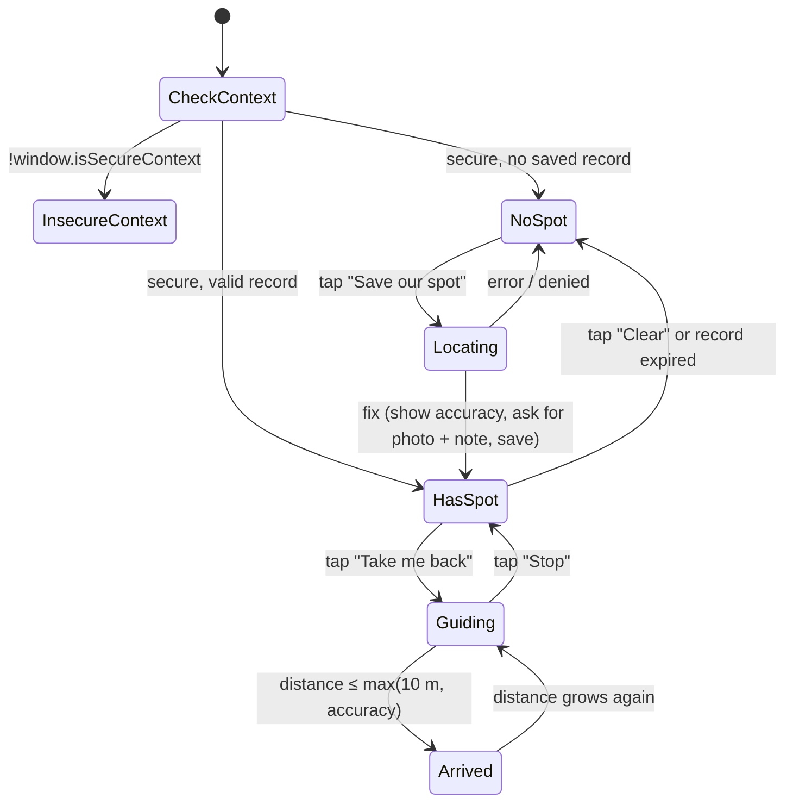

# Chhath Ghat Guide — Low-Level Design (LLD)

| | |
| --- | --- |
| **Version** | 0.1 (draft) |
| **Date** | 10 Oct 2026 |
| **Author** | Sameer |
| **Related** | [HLD](HLD.md) · [README](../README.md) |

This document turns the [HLD](HLD.md) into code-level detail: repository layout, modules and their interfaces, data formats, prompts, algorithms, configuration, error handling and tests. Names here are the names to use in code.

---

## 1. Repository layout

```text
Chhath_Ghat_Guide-/
├── app.py                         # Streamlit entry point: page config, sidebar, tabs
├── ghat_guide/
│   ├── __init__.py
│   ├── config.py                  # loads config/settings.toml → Settings dataclass
│   ├── i18n.py                    # UI strings per language, t(key, lang)
│   ├── prompts.py                 # prompt templates + JSON schemas
│   ├── llm.py                     # LLMGateway: the only module that calls Ollama
│   ├── imaging.py                 # prepare_image(): EXIF-fix, strip, resize, JPEG
│   ├── safety.py                  # safety keyword check, clarity rules, number check
│   ├── notice_reader.py           # NoticeReader.read(image, lang) → NoticeResult
│   ├── geo.py                     # haversine / bearing (Python mirror of the JS, for tests)
│   ├── ritual/
│   │   ├── __init__.py
│   │   ├── kb_loader.py           # parse kb/*.md → list[Chunk]
│   │   ├── index.py               # build / load / cache embeddings
│   │   ├── retriever.py           # hybrid keyword + vector search
│   │   └── answerer.py            # RitualHelper.ask(question, lang) → RitualAnswer
│   └── ui/
│       ├── __init__.py
│       ├── sidebar.py             # language picker, emergency card, clear-data button
│       ├── notice_tab.py
│       ├── ritual_tab.py
│       └── meeting_tab.py         # embeds static/meeting_spot.html
├── static/
│   └── meeting_spot.html          # self-contained HTML+JS widget (no external assets)
├── kb/                            # checked ritual notes (Markdown + front matter)
│   ├── 01-chhath-overview.md
│   ├── 02-nahay-khay.md
│   ├── 03-kharna.md
│   ├── 04-sandhya-arghya.md
│   ├── 05-usha-arghya.md
│   ├── 06-soop-daura-offerings.md
│   ├── 07-thekua-and-prasad.md
│   ├── 08-fasting-customs.md
│   ├── 09-chhathi-maiya-and-surya.md
│   └── 10-at-the-ghat-etiquette.md
├── config/
│   ├── settings.toml              # models, thresholds, limits
│   └── emergency.yaml             # organiser-editable; ships with no phone numbers
├── .streamlit/
│   └── config.toml                # server, static serving, HTTPS, no telemetry
├── scripts/
│   ├── make_cert.sh               # self-signed cert with hotspot IP in SAN
│   ├── build_index.py             # pre-build KB index before going offline
│   └── check_offline.py           # verifies models present, no outbound calls needed
├── data/                          # generated; git-ignored (kb_index.npz, kb_index.json)
├── certs/                         # generated; git-ignored
├── tests/
│   ├── test_geo.py
│   ├── test_safety.py
│   ├── test_imaging.py
│   ├── test_kb_loader.py
│   ├── test_retriever.py
│   ├── test_answerer.py
│   └── eval/
│       ├── ritual_questions.yaml  # in-KB and out-of-KB questions with expectations
│       ├── run_ritual_eval.py     # runs the questions against Ollama, prints hit / false-answer rates
│       └── notices/               # sample notice photos (no identifiable people)
├── docs/
│   ├── HLD.md
│   └── LLD.md
├── requirements.txt
├── LICENSE                        # MIT
└── README.md
```

### 1.1 Dependencies (`requirements.txt`)

```text
streamlit>=1.38
ollama>=0.4
pillow>=10.4
numpy>=1.26
pyyaml>=6.0
python-frontmatter>=1.1
# P1 only
# faster-whisper>=1.0
```

Python 3.10+. `tomllib` (stdlib, 3.11+) or `tomli` on 3.10.

## 2. Configuration

### 2.1 `config/settings.toml`

```toml
[ollama]
host = "http://127.0.0.1:11434"
vision_model = "gemma3:4b"
text_model = "gemma3:4b"
embed_model = "nomic-embed-text"
keep_alive = "30m"
timeout_s = 180
max_retries = 1                 # retries on invalid JSON only

[notice]
max_image_px = 1024             # long side
jpeg_quality = 85
transcribe_temperature = 0.0
explain_temperature = 0.2
min_text_chars = 8              # shorter → unclear
max_unknown_ratio = 0.30        # share of "[?]" tokens → unclear

[ritual]
top_k = 4
min_score = 0.45                # tune on tests/eval/ritual_questions.yaml
weight_vector = 0.6
weight_keyword = 0.4
answer_temperature = 0.1
index_path = "data/kb_index"

[ui]
default_language = "hi"         # hi | bho | mai
beta_languages = ["bho", "mai"]
```

`ghat_guide/config.py` exposes:

```python
@dataclass(frozen=True)
class Settings:
    ollama: OllamaSettings
    notice: NoticeSettings
    ritual: RitualSettings
    ui: UISettings

def load_settings(path: str = "config/settings.toml") -> Settings: ...
```

Environment overrides (for quick tests): `GHAT_VISION_MODEL`, `GHAT_TEXT_MODEL`, `GHAT_OLLAMA_HOST`.

### 2.2 `config/emergency.yaml`

```yaml
# Organisers: fill in local, verified details on the day. Leave empty if unknown.
# The app never ships with made-up numbers.
message:
  hi: "किसी भी परेशानी में सबसे पास के पुलिस या स्वयंसेवक बूथ पर जाएँ।"
  bho: "कवनो दिक्कत होखे त सबसे नजदीक के पुलिस भा वॉलंटियर बूथ पर जाईं।"
  mai: "कोनो समस्या मे सबसँ लग के पुलिस वा स्वयंसेवक बूथ पर जाउ।"
contacts: []          # e.g. - {label: "Ghat 5 police booth", phone: "...", where: "..."}
```

> Bhojpuri and Maithili strings in this document are drafts and must be checked by a native speaker before the demo.

### 2.3 `.streamlit/config.toml`

```toml
[server]
address = "0.0.0.0"
port = 8501
headless = true
enableStaticServing = true          # serves ./static at /app/static/
maxUploadSize = 15                  # MB
# For hotspot mode, uncomment after running scripts/make_cert.sh:
# sslCertFile = "certs/cert.pem"
# sslKeyFile  = "certs/key.pem"

[browser]
gatherUsageStats = false

[theme]
base = "light"
```

## 3. Core modules

### 3.1 `llm.py` — LLM gateway

The **only** module that imports `ollama`. Everything else depends on this interface so the model can be swapped or mocked in tests.

```python
class LLMError(Exception): ...
class LLMUnavailable(LLMError): ...   # server down / model not pulled
class LLMTimeout(LLMError): ...
class LLMBadOutput(LLMError): ...     # invalid JSON after retries

class LLMGateway:
    def __init__(self, s: OllamaSettings): ...

    def health(self) -> dict[str, bool]:
        """{'server': bool, 'vision_model': bool, 'embed_model': bool} via client.list()."""

    def warm_up(self) -> None:
        """Tiny text call with keep_alive so the first real request is fast."""

    def chat_json(self, *, model: str, system: str, user: str,
                  schema: dict, temperature: float,
                  images: list[bytes] | None = None) -> dict:
        """Calls client.chat(..., format=schema, options={'temperature': t},
        keep_alive=...). Holds _LOCK for the call. Parses JSON, validates
        required keys, retries max_retries times on bad output."""

    def embed(self, texts: list[str]) -> np.ndarray:
        """client.embed(model=embed_model, input=texts) → float32 (n, d), L2-normalised."""
```

Implementation notes:

- `_LOCK = threading.Lock()` at module level — Streamlit runs each browser session in its own thread; the lock makes model calls one-at-a-time. Before waiting, the UI shows `t("queue_wait")`.
- Timeouts: `ollama.Client(host=..., timeout=timeout_s)`. `httpx.TimeoutException` → `LLMTimeout`; `httpx.ConnectError` → `LLMUnavailable`; `ollama.ResponseError` with status 404 → `LLMUnavailable("model not pulled")`.
- Created once per process with `@st.cache_resource def get_llm() -> LLMGateway`.

### 3.2 `imaging.py`

```python
def prepare_image(raw: bytes, max_px: int = 1024, quality: int = 85) -> bytes:
    """
    1. Image.open(BytesIO(raw)); ImageOps.exif_transpose() to fix rotation.
    2. Convert to RGB (drops alpha / palette).
    3. thumbnail((max_px, max_px), Image.LANCZOS) — keeps aspect, never upsizes.
    4. Save to new JPEG **without** exif/icc → strips GPS and device metadata.
    Raises ImageError on unreadable input or > 40 MP (decompression-bomb guard).
    """
```

### 3.3 `safety.py`

```python
SAFETY_KEYWORDS: dict[str, list[str]]   # by language, all normalised (see below)
# hi/bho/mai share most terms, e.g.:
#   गहरा, गहराई, गहरे पानी, डूब, खतरा, खतरनाक, सावधान, चेतावनी,
#   बैरिकेड, घेरा, प्रतिबंधित, वर्जित, मना है, प्रवेश निषेध,
#   आपात, आपातकाल, पुलिस, गोताखोर, NDRF, SDRF, खोया, खोया-पाया, एम्बुलेंस
# en: danger, deep, warning, barricade, prohibited, no entry,
#     emergency, police, lost, found, ambulance

def normalise(text: str) -> str:
    """NFC normalise, lower-case Latin, Devanagari digits → ASCII,
    collapse whitespace, remove nukta variants (ज़→ज, ड़ kept)."""

def is_safety_notice(text_read: str) -> bool

def clarity_verdict(text_read: str, model_clarity: str,
                    min_chars: int, max_unknown_ratio: float) -> Literal["clear", "partial", "unclear"]:
    """
    unclear if  model_clarity == "unclear"
            or  len(text_read.strip()) < min_chars
            or  count("[?]") / max(1, word_count) > max_unknown_ratio
    partial if  model_clarity == "partial" or any "[?]" present
    else clear
    """

def unsupported_numbers(explanation: str, text_read: str) -> set[str]:
    """Numbers (after digit normalisation) that appear in the explanation
    but not in the transcription. Non-empty → show 'check numbers against
    the original text' warning. Used to catch invented times / ghat numbers."""
```

### 3.4 `notice_reader.py`

```python
@dataclass
class NoticeResult:
    text_read: str                 # verbatim, original script
    script: str                    # "devanagari" | "latin" | "mixed" | "other"
    clarity: Literal["clear", "partial", "unclear"]
    is_safety: bool
    explanation: str | None        # None when unclear
    highlights: Highlights | None  # P1; None until implemented
    number_warning: set[str]       # from unsupported_numbers()
    elapsed_s: float

@dataclass
class Highlights:                  # P1
    times: list[str]
    ghat_numbers: list[str]
    dos: list[str]
    donts: list[str]

class NoticeReader:
    def __init__(self, llm: LLMGateway, s: NoticeSettings): ...

    def read(self, raw_image: bytes, lang: str) -> NoticeResult:
        img = prepare_image(raw_image, s.max_image_px, s.jpeg_quality)
        t = llm.chat_json(model=vision_model, system=SYS_TRANSCRIBE,
                          user=USER_TRANSCRIBE, schema=TRANSCRIBE_SCHEMA,
                          temperature=s.transcribe_temperature, images=[img])
        clarity = clarity_verdict(t["text_read"], t["clarity"], ...)
        is_safety = is_safety_notice(t["text_read"])
        if clarity == "unclear":
            return NoticeResult(..., explanation=None)
        e = llm.chat_json(model=text_model, system=SYS_EXPLAIN[lang],
                          user=USER_EXPLAIN.format(text=t["text_read"]),
                          schema=EXPLAIN_SCHEMA, temperature=s.explain_temperature)
        return NoticeResult(..., explanation=e["explanation"],
                            number_warning=unsupported_numbers(e["explanation"], t["text_read"]))
```

### 3.5 `ritual/kb_loader.py`

**Note format** (`kb/04-sandhya-arghya.md`):

```markdown
---
id: sandhya-arghya
title: Sandhya Arghya
title_hi: संध्या अर्घ्य
day: 3
keywords: [अर्घ्य, अरघ, संध्या, शाम, डूबते सूरज, sandhya, arghya, argh, evening]
checked_by: "Nani (family elder)"
checked_on: 2026-10-10
---

## क्या होता है
...author's own words...

## कब
...describe relative to sunset; no fixed clock times...

## किन बातों का ध्यान रखें
...

## परिवारों में अंतर
...
```

Rules:

- Front matter keys `id`, `title_hi`, `keywords`, `checked_by`, `checked_on` are **required**. A note without `checked_by` is skipped with a warning (unchecked text never reaches users).
- Notes contain **no fixed clock times or dates**; timings are described relative to sunrise / sunset.

```python
@dataclass(frozen=True)
class Chunk:
    chunk_id: str        # f"{note_id}#{section_slug}"
    note_id: str
    note_title: str      # title_hi
    section: str         # H2 heading text
    text: str            # section body
    keywords: tuple[str, ...]   # note keywords + words from heading

def load_kb(kb_dir: str = "kb") -> list[Chunk]:
    """Parse each .md with python-frontmatter, split body on '## ' headings,
    one Chunk per section; drop empty sections."""

def kb_fingerprint(kb_dir: str) -> str:
    """sha256 over sorted (filename, file bytes); used to invalidate the index."""
```

### 3.6 `ritual/index.py`

```python
@dataclass
class KBIndex:
    chunks: list[Chunk]
    vectors: np.ndarray        # (n_chunks, d) float32, L2-normalised
    fingerprint: str
    embed_model: str

def build_index(chunks, llm) -> KBIndex:
    docs = [f"search_document: {c.note_title} — {c.section}\n{c.text}" for c in chunks]
    return KBIndex(chunks, llm.embed(docs), fingerprint, embed_model)

def load_or_build(kb_dir, index_path, llm) -> KBIndex:
    """Load data/kb_index.npz + .json if fingerprint and embed_model match,
    else rebuild and save. Wrapped in @st.cache_resource in the UI layer."""
```

`nomic-embed-text` expects the task prefixes `search_document:` and `search_query:`; they are added here and in the retriever.

### 3.7 `ritual/retriever.py` — hybrid search

```python
@dataclass
class Hit:
    chunk: Chunk
    score: float          # combined, 0..1
    vector_score: float
    keyword_score: float

class Retriever:
    def __init__(self, index: KBIndex, llm: LLMGateway, s: RitualSettings): ...
    def search(self, question: str) -> list[Hit]: ...
```

Algorithm:

1. `q = normalise(question)`; tokens = split on whitespace and punctuation; drop a small stop-word list (क्या, कब, है, में, के, की, को, ka, ki, kya, …).
2. **Vector score:** `v = llm.embed([f"search_query: {question}"])[0]`; `vec = index.vectors @ v` (cosine, since both normalised); clip to `[0, 1]`.
3. **Keyword score** per chunk: `kw = |tokens ∩ chunk_terms| / max(1, |tokens|)` where `chunk_terms` = normalised `keywords` + words of `section` + words of `note_title`. Simple synonym map applied to tokens first (e.g. `अरघ → अर्घ्य`, `argh → अर्घ्य`, `सूपा → सूप`, `kharna → खरना`).
4. `score = weight_vector * vec + weight_keyword * kw`.
5. Sort descending; return top `top_k`.
6. Caller treats `hits[0].score < min_score` (or no hits) as **not found**.

Why hybrid: `nomic-embed-text` is trained mostly on English, so Devanagari queries alone can rank poorly; the hand-written `keywords` field gives reliable matches for the common words families actually use.

### 3.8 `ritual/answerer.py`

```python
@dataclass
class RitualAnswer:
    found: bool
    answer: str                 # model answer, or fallback text
    sources: list[Hit]          # shown in an expander
    elapsed_s: float

class RitualHelper:
    def ask(self, question: str, lang: str) -> RitualAnswer:
        q = question.strip()
        if not q: raise ValueError
        if len(q) > 300: q = q[:300]
        hits = retriever.search(q)
        if not hits or hits[0].score < s.min_score:
            return RitualAnswer(False, t("not_in_notes", lang), hits, ...)
        context = "\n\n".join(f"[{h.chunk.chunk_id}]\n{h.chunk.text}" for h in hits)
        out = llm.chat_json(model=text_model, system=SYS_RITUAL[lang],
                            user=USER_RITUAL.format(context=context, question=q),
                            schema=RITUAL_SCHEMA, temperature=s.answer_temperature)
        allowed = {h.chunk.chunk_id for h in hits}
        if not out["found"] or not out["used_chunk_ids"] \
           or not set(out["used_chunk_ids"]) <= allowed:
            return RitualAnswer(False, t("not_in_notes", lang), hits, ...)
        return RitualAnswer(True, out["answer"] + "\n\n" + t("customs_vary", lang),
                            [h for h in hits if h.chunk.chunk_id in out["used_chunk_ids"]], ...)
```

### 3.9 `geo.py` (Python mirror of the widget maths)

```python
R_EARTH_M = 6_371_000

def haversine_m(lat1, lon1, lat2, lon2) -> float:
    φ1, φ2 = radians(lat1), radians(lat2)
    dφ, dλ = radians(lat2 - lat1), radians(lon2 - lon1)
    a = sin(dφ/2)**2 + cos(φ1) * cos(φ2) * sin(dλ/2)**2
    return 2 * R_EARTH_M * asin(sqrt(a))

def bearing_deg(lat1, lon1, lat2, lon2) -> float:
    """Initial bearing from point 1 to point 2, degrees clockwise from true north."""
    φ1, φ2 = radians(lat1), radians(lat2)
    dλ = radians(lon2 - lon1)
    x = sin(dλ) * cos(φ2)
    y = cos(φ1) * sin(φ2) - sin(φ1) * cos(φ2) * cos(dλ)
    return (degrees(atan2(x, y)) + 360) % 360

def compass_point(deg: float, lang: str) -> str:
    """8-point name, e.g. 'उत्तर-पूर्व'."""
```

`static/meeting_spot.html` implements the same three functions in JS; `tests/test_geo.py` pins known values so both stay in sync (same fixtures copied into a JS self-test run with `?selftest=1`).

## 4. Prompts and output schemas (`prompts.py`)

All structured outputs use Ollama's `format=<JSON schema>`. Prompts are in English (Gemma follows English instructions most reliably) with the **output language** stated explicitly.

### 4.1 Transcribe (vision)

```text
SYSTEM:
You read photos of public notices, banners and signs at a river ghat in Bihar, India.
Copy the text exactly as written, in its original script and language.
- Do not translate, summarise or correct spelling.
- Keep line breaks.
- Write [?] for any word you cannot read with confidence.
- Do not guess numbers, times or ghat numbers; if unsure, write [?].
- If there is no readable text, return an empty text_read.
Rate clarity: "clear" (all text readable), "partial" (some words unreadable),
"unclear" (most text unreadable or no notice in the photo).

USER:
Read all text in this photo.
```

```json
{
  "type": "object",
  "properties": {
    "text_read": {"type": "string"},
    "script":    {"type": "string", "enum": ["devanagari", "latin", "mixed", "other"]},
    "clarity":   {"type": "string", "enum": ["clear", "partial", "unclear"]}
  },
  "required": ["text_read", "script", "clarity"]
}
```

### 4.2 Explain (text)

```text
SYSTEM:
You explain public notices to a family at a Chhath ghat, in simple {LANGUAGE_NAME}
({LANGUAGE_NATIVE}). Use short sentences an elder can follow when read aloud.
Rules:
- Use ONLY the notice text given. Do not add any time, date, ghat number,
  place, phone number or instruction that is not in it.
- If a part is marked [?], say that part could not be read.
- Keep any warning about water, barricades, crowding or emergencies first.
- Respectful tone. No jokes.
{STYLE_EXAMPLES_FOR_LANGUAGE}

USER:
Notice text:
"""
{text}
"""
Explain what this notice says and what the family should do.
```

```json
{
  "type": "object",
  "properties": {
    "explanation": {"type": "string"},
    "highlights": {
      "type": "object",
      "properties": {
        "times":        {"type": "array", "items": {"type": "string"}},
        "ghat_numbers": {"type": "array", "items": {"type": "string"}},
        "dos":          {"type": "array", "items": {"type": "string"}},
        "donts":        {"type": "array", "items": {"type": "string"}}
      }
    }
  },
  "required": ["explanation"]
}
```

`highlights` is optional in P0 and rendered only when the P1 flag is on.

### 4.3 Ritual answer (text)

```text
SYSTEM:
You help a family with questions about Chhath Puja. Answer in simple {LANGUAGE_NAME}.
Use ONLY the notes given between <notes> tags. Each note starts with its id in [brackets].
- If the notes do not answer the question, set found=false and leave answer empty.
- Do not add facts, dates, clock times or rules that are not in the notes.
- Customs differ between families and regions; never call one way the only correct way.
- List the ids of the notes you used in used_chunk_ids.
- Respectful tone. 2–5 short sentences.

USER:
<notes>
{context}
</notes>
Question: {question}
```

```json
{
  "type": "object",
  "properties": {
    "found":          {"type": "boolean"},
    "answer":         {"type": "string"},
    "used_chunk_ids": {"type": "array", "items": {"type": "string"}}
  },
  "required": ["found", "answer", "used_chunk_ids"]
}
```

### 4.4 Language table

| Code | `LANGUAGE_NAME` | `LANGUAGE_NATIVE` | UI label | Status |
| --- | --- | --- | --- | --- |
| `hi` | Hindi | हिन्दी | हिन्दी | default |
| `bho` | Bhojpuri | भोजपुरी | भोजपुरी (β) | beta |
| `mai` | Maithili | मैथिली | मैथिली (β) | beta |

`STYLE_EXAMPLES_FOR_LANGUAGE` holds 2–3 short checked sentences in that language to steer the model away from drifting into Hindi.

## 5. UI layer

### 5.1 `app.py`

```python
st.set_page_config(page_title="Chhath Ghat Guide", page_icon="🌅", layout="centered")
settings = load_settings()
llm = get_llm()                     # cached resource; warm_up() on first creation
lang = render_sidebar(settings)     # returns "hi" | "bho" | "mai"
render_health_banner(llm)           # only if Ollama / models missing
tab1, tab2, tab3 = st.tabs([t("tab_notice", lang), t("tab_ritual", lang), t("tab_meeting", lang)])
with tab1: notice_tab.render(lang)
with tab2: ritual_tab.render(lang)
with tab3: meeting_tab.render(lang)
```

### 5.2 Session state

| Key | Type | Purpose |
| --- | --- | --- |
| `lang` | `str` | Selected language |
| `notice_result` | `NoticeResult \| None` | Last result, so reruns don't re-call the model |
| `notice_image_hash` | `str \| None` | sha1 of last image; new image → new call |
| `ritual_history` | `list[tuple[str, RitualAnswer]]` | Last 5 Q&A in this session |

Nothing is persisted on the server between sessions.

### 5.3 Notice tab (`ui/notice_tab.py`)

1. `st.camera_input(t("take_photo"))` and `st.file_uploader(t("upload_photo"), type=["jpg","jpeg","png","webp","heic"*])` — whichever has data is used. (*HEIC only if `pillow-heif` is installed; otherwise ask the user to pick JPEG.)
2. On new image → `with st.spinner(t("reading")):` → `reader.read(...)`.
3. Render:
   - **Unclear:** `st.warning("साफ़ नहीं पढ़ पाए")` + tips + whatever text was read (if any).
   - **Safety notice:** `st.error` box titled `t("safety_original")` with `text_read` *first*, then the explanation.
   - **Normal:** explanation (`st.markdown`), then `st.expander(t("original_text"), expanded=True)` with `text_read` in a code block.
   - `number_warning` non-empty → `st.warning(t("check_numbers"))`.
   - Footer: `t("notice_disclaimer")` — "Official announcements and volunteers come first."
4. Errors: `LLMUnavailable` → setup instructions; `LLMTimeout` → retry tip; `ImageError` → "photo could not be opened".

### 5.4 Ritual tab (`ui/ritual_tab.py`)

- `st.text_input` with placeholder `अर्घ्य कब दिया जाता है?` and 4–6 tappable example questions (`st.button` chips).
- Answer card: answer text; if `found` is false, the fallback text with an icon of an elder ("किसी बड़े से पूछें").
- `st.expander(t("sources"))` lists each source note title, section and `checked_by` / `checked_on`.
- P1: microphone input → `faster-whisper` (`small` model, `int8`, language hint `hi`) → same `ask()` path.

### 5.5 Meeting tab (`ui/meeting_tab.py`)

```python
html = Path("static/meeting_spot.html").read_text(encoding="utf-8")
html = html.replace("__LANG__", lang).replace("__STRINGS__", json.dumps(strings_for(lang)))
st.components.v1.html(html, height=720, scrolling=True)
st.link_button(t("open_full_screen"), f"app/static/meeting_spot.html?lang={lang}")
st.caption(t("meeting_disclaimer"))   # short distances only; GPS ±5–20 m; not a lost-person tracker
```

The full-screen link is the fallback if the browser blocks sensors inside the component iframe. The static page reads `lang` from the query string and has its own built-in Hindi strings.

## 6. Meeting Spot widget (`static/meeting_spot.html`)

Self-contained: inline CSS and JS, no network requests, system fonts.

### 6.1 Stored record

`localStorage["ghat_guide.meeting_spot.v1"]`:

```json
{
  "v": 1,
  "lat": 25.6093,
  "lon": 85.1376,
  "accuracy_m": 12,
  "note": "नीला टेंट, घाट 5 की सीढ़ियों के पास",
  "photo": "data:image/jpeg;base64,...",
  "saved_at": "2026-11-15T16:42:10+05:30",
  "expires_at": "2026-11-16T00:00:00+05:30"
}
```

- Photo is downscaled in a `<canvas>` to max 640 px, JPEG quality 0.7 (≈ 40–80 KB) to stay well within the ~5 MB `localStorage` quota.
- `expires_at` = next local midnight. On load, an expired record is deleted.
- Storage access is wrapped in `try/catch`; if storage is unavailable (private mode), the spot is kept in memory and the user is told it will be lost if the page closes.
- "मिटाएँ / Clear" button removes the key.

### 6.2 State machine



### 6.3 Geolocation

- Save: `navigator.geolocation.getCurrentPosition(ok, err, {enableHighAccuracy: true, timeout: 20000, maximumAge: 0})`. If `accuracy > 30 m`, show "location is rough; wait a few seconds and try again" with a "save anyway" option.
- Guide: `watchPosition` with the same options; `clearWatch` on stop or page hide (`visibilitychange`) to save battery.
- Errors: `PERMISSION_DENIED` → how to enable location for this site; `POSITION_UNAVAILABLE` → go to open sky, away from tents; `TIMEOUT` → retry.

### 6.4 Compass heading

```js
async function startCompass() {
  // iOS 13+: permission must be requested from a user gesture
  if (typeof DeviceOrientationEvent?.requestPermission === "function") {
    const r = await DeviceOrientationEvent.requestPermission();
    if (r !== "granted") return useTextDirections();
  }
  if ("ondeviceorientationabsolute" in window) {
    window.addEventListener("deviceorientationabsolute", onAbs);   // Android Chrome
  } else {
    window.addEventListener("deviceorientation", onIOS);           // iOS Safari
  }
  setTimeout(() => { if (heading === null) useTextDirections(); }, 3000);
}
function onAbs(e) { if (e.alpha != null) setHeading(360 - e.alpha); }
function onIOS(e) { if (e.webkitCompassHeading != null) setHeading(e.webkitCompassHeading); }
function setHeading(h) {
  const screenAngle = (screen.orientation && screen.orientation.angle) || 0;
  heading = (h + screenAngle + 360) % 360;
  render();
}
```

- Smoothing: circular low-pass (`atan2` of averaged sin/cos over the last 5 readings) to stop the arrow jittering.
- **Arrow rotation** = `(bearing(current → spot) − heading + 360) % 360`, applied as CSS `transform: rotate(...)` on an SVG arrow.
- **No compass** (laptop, denied, no events in 3 s): show distance + compass point in words, e.g. "उत्तर-पूर्व की ओर लगभग 40 मीटर".
- Prompt to "hold the phone flat" and a one-time "move the phone in a figure-8" calibration hint.

### 6.5 Display rules

| Condition | Shown |
| --- | --- |
| `distance ≤ max(10, accuracy)` | "आप पहुँच गए / बहुत पास हैं — निशानी देखें" + landmark photo large |
| `distance < accuracy` (but > 10 m) | Distance with "±accuracy m" and "GPS is rough here — look for the landmark" |
| Otherwise | Big arrow, distance rounded (≤ 100 m to 5 m; else to 10 m), note, photo thumbnail |
| Saved > 6 h ago | Small "saved at 4:42 PM" reminder so stale spots are noticed |

## 7. Self-signed HTTPS (`scripts/make_cert.sh`)

```bash
#!/usr/bin/env bash
# Usage: scripts/make_cert.sh 192.168.137.1
set -euo pipefail
IP="${1:?hotspot IP required}"
mkdir -p certs
openssl req -x509 -newkey rsa:2048 -nodes -days 30 \
  -keyout certs/key.pem -out certs/cert.pem \
  -subj "/CN=Chhath Ghat Guide" \
  -addext "subjectAltName=IP:${IP},DNS:localhost"
echo "Now set sslCertFile/sslKeyFile in .streamlit/config.toml and open https://${IP}:8501"
```

Common hotspot IPs: Windows Mobile Hotspot `192.168.137.1`; macOS Internet Sharing `192.168.2.1`; Linux NetworkManager hotspot `10.42.0.1`. Check with `ipconfig` / `ifconfig` / `ip addr`.

## 8. Error handling summary

| Source | Exception / signal | User sees (Hindi) | Logged |
| --- | --- | --- | --- |
| Ollama down | `LLMUnavailable` | "मॉडल चालू नहीं है — लैपटॉप पर `ollama serve` चलाएँ" | yes |
| Model not pulled | `LLMUnavailable` | "मॉडल नहीं मिला — `ollama pull gemma3:4b`" | yes |
| Slow model | `LLMTimeout` | "बहुत समय लग रहा है — पास से, साफ़ फोटो लें" | yes |
| Bad JSON | `LLMBadOutput` | Notice: unclear; Ritual: not in notes | yes (no user text) |
| Bad image | `ImageError` | "फोटो खुल नहीं पाई" | yes |
| Empty question | `ValueError` | "कृपया सवाल लिखें" | no |
| KB index stale | — | Rebuilds silently on start (seconds) | yes |
| No checked notes | — | Ritual tab disabled with explanation | yes |

Logging uses `logging` at INFO to stdout; it records timings, model names and error types, **never** question text, image data, transcriptions or coordinates.

## 9. Testing

### 9.1 Unit tests (`pytest`, no Ollama needed — `LLMGateway` is faked)

| Test file | Covers |
| --- | --- |
| `test_geo.py` | Haversine and bearing against known pairs (same point → 0 m; 0.001° lat ≈ 111 m north → bearing 0°; due east → 90°; wrap-around at 359°/1°). |
| `test_safety.py` | Keyword detection in hi / bho / mai / en; Devanagari digit normalisation; `clarity_verdict` thresholds; `unsupported_numbers` catches an invented "घाट 7". |
| `test_imaging.py` | EXIF GPS removed; rotation applied; long side ≤ 1024; small images not upscaled; corrupt bytes → `ImageError`. |
| `test_kb_loader.py` | Front matter parsed; sections split; note without `checked_by` skipped; fingerprint changes when a note changes. |
| `test_retriever.py` | With fake embeddings: keyword synonyms hit the right note; nonsense question scores below `min_score`. |
| `test_answerer.py` | `found=false` → fallback; cited id not in hits → fallback; valid answer gets "customs vary" line. |

### 9.2 Model evaluation (run with Ollama, Saturday)

- `tests/eval/ritual_questions.yaml`: ~20 questions — 14 answerable from the KB (with expected note id), 6 not in the KB (e.g. "इस साल अर्घ्य कितने बजे है?", "घाट पर पार्किंग कहाँ है?"). Script prints retrieval hit-rate, false-answer rate, and per-language output for manual review. **Target: 0 confident answers to out-of-KB questions.** Use it to set `min_score`.
- `tests/eval/notices/`: 8–10 photos (printed sample notices, real banners without people). Record per photo: transcription accuracy (manual), clarity verdict, explanation correctness, latency. Decide the default language from these results.

### 9.3 Field test checklist (Sunday, ghat / riverbank)

- [ ] Phone mobile data **off**, laptop internet **off**; hotspot on.
- [ ] Phone opens `https://<ip>:8501` after accepting the certificate.
- [ ] Notice Reader on 3 real notices; latency noted.
- [ ] Ritual Helper: 3 answerable + 2 unanswerable questions.
- [ ] Meeting Spot: save, walk 50–100 m away, "take me back" works with the arrow; accuracy noted near the water.
- [ ] Widget still works after closing the laptop lid (page already loaded).
- [ ] "Clear" removes the saved spot.

## 10. Build sequence (maps to the PRD plan)

| Slot (IST) | Deliverable | Modules |
| --- | --- | --- |
| Sat morning | Ollama + Gemma working; transcribe/explain one photo in hi/bho/mai | `llm.py`, `imaging.py`, `prompts.py` |
| Sat afternoon | Notice tab end-to-end | `notice_reader.py`, `safety.py`, `ui/notice_tab.py`, `app.py`, `i18n.py` |
| Sat evening | 8–12 KB notes checked by an elder; Ritual tab | `kb/`, `ritual/*`, `ui/ritual_tab.py`, `scripts/build_index.py` |
| Sun morning | Meeting Spot widget; outdoor test | `static/meeting_spot.html`, `ui/meeting_tab.py`, `geo.py` |
| Sun afternoon | Field test with data off | `scripts/make_cert.sh`, `scripts/check_offline.py` |
| Sun night | README, demo video, DEV post draft | `README.md`, `docs/` |

If time runs out, cut in this order: `highlights` (P1) → voice (P1) → compass smoothing → full-screen static page link.
