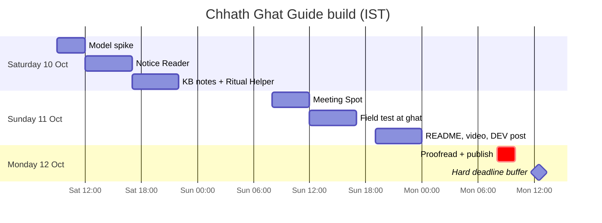

# Chhath Ghat Guide — Build Plan

| | |
| --- | --- |
| **Owner** | Sameer |
| **Start** | Sat 10 Oct 2026 |
| **Hard deadline** | **Mon 12 Oct 2026, 12:29 PM IST** (Sun 11 Oct, 11:59 PM PDT) |
| **Publish target** | Mon 12 Oct, 10:00 AM IST |
| **Related** | [README](README.md) · [HLD](docs/HLD.md) · [LLD](docs/LLD.md) |

This plan turns the PRD's two-day schedule into concrete tasks. Each task names the files it touches (from the [LLD](docs/LLD.md)) and a **done when** check. Work in order: the riskiest part (the model) comes first.

**Rule:** P0 first. Start P1 only if every P0 task is done by **Sun 6:00 PM IST**. Three working P0 tabs beat one polished tab and two broken ones.

---

## Status at a glance

| Phase | Slot (IST) | Status |
| --- | --- | --- |
| 0. Design docs | Sat early | ✅ Done (HLD, LLD, README, LICENSE merged) |
| 1. Model spike | Sat morning | 🟡 Code done; model test pending on laptop |
| 2. Notice Reader | Sat afternoon | 🟡 Built and tested with a stand-in model; real-model check pending on laptop |
| 3. Knowledge base + Ritual Helper | Sat evening | ⬜ |
| 4. Meeting Spot | Sun morning | ⬜ |
| 5. Field test (data off) | Sun afternoon | ⬜ |
| 6. Docs, video, DEV post | Sun night | ⬜ |
| 7. Proofread and publish | Mon by 10:00 AM | ⬜ |

---

## Phase 0 — Design docs ✅

- [x] PRD written
- [x] `docs/HLD.md`, `docs/LLD.md`, `README.md`, `LICENSE` merged to `main`
- [x] `main` set as the default branch

## Phase 1 — Model spike (Sat morning, ~3 h)

Goal: prove Gemma can read a notice and answer in Hindi / Bhojpuri / Maithili on this laptop, before building anything else.

- [ ] **1.1 Install** Ollama; `ollama pull gemma3:4b` and `ollama pull nomic-embed-text`.
  *Done when:* `ollama list` shows both models.
- [x] **1.2 Project skeleton**: `requirements.txt`, `.gitignore` (`data/`, `certs/`, `.venv/`), `config/settings.toml`, `ghat_guide/__init__.py`, `ghat_guide/config.py`.
  *Done when:* `python -c "from ghat_guide.config import load_settings; print(load_settings())"` works.
- [x] **1.3 LLM gateway** `ghat_guide/llm.py`: `health()`, `warm_up()`, `chat_json()` with JSON schema + lock + timeout, `embed()`.
  *Done when:* a one-line script gets valid JSON back from `gemma3:4b`.
- [x] **1.4 Image prep** `ghat_guide/imaging.py`: EXIF rotate, strip metadata, resize to 1024 px.
  *Done when:* `tests/test_imaging.py` passes (GPS EXIF removed, long side ≤ 1024).
- [x] **1.5 Prompts** `ghat_guide/prompts.py`: transcribe + explain prompts and schemas (LLD §4.1–4.2).
- [ ] **1.6 Spike test** on 3–5 notice photos (print a few sample notices if no real ones yet), in all three languages. Put photos in `tests/eval/notices/` and run `python scripts/spike_notice.py`; it appends text read, explanations and timings to `tests/eval/notice_log.md`. Fill in the score tables by hand.
  *Done when:* the log is filled in.
- [ ] **1.7 Decide** the default language and whether Bhojpuri / Maithili stay "beta". Update `config/settings.toml` → `default_language`.

**Go / no-go at end of Phase 1:**
- Photo takes > 120 s → drop `max_image_px` to 768 and retest.
- Transcription is poor on clear photos → try `gemma3:12b` if RAM allows; otherwise keep 4B and say so in the post.
- Bhojpuri / Maithili drift into Hindi → keep Hindi default, mark them β, add style examples to prompts.

## Phase 2 — Notice Reader tab (Sat afternoon, ~5 h)

- [x] **2.1 Safety** `ghat_guide/safety.py`: `normalise()`, `is_safety_notice()`, `clarity_verdict()`, `unsupported_numbers()`.
  *Done when:* `tests/test_safety.py` passes.
- [x] **2.2 Service** `ghat_guide/notice_reader.py`: two-step read → `NoticeResult` (LLD §3.4).
- [x] **2.3 Strings** `ghat_guide/i18n.py`: `t(key, lang)` with Hindi complete; Bhojpuri / Maithili fall back to Hindi.
- [x] **2.4 App shell** `app.py` + `ghat_guide/ui/sidebar.py`: page config, language picker, health banner, emergency card from `config/emergency.yaml`, three tabs.
- [x] **2.5 Notice tab** `ghat_guide/ui/notice_tab.py`: camera + upload; unclear / safety / normal views; number warning; disclaimer.
- [x] **2.6 Streamlit config** `.streamlit/config.toml`: no usage stats, static serving on, upload limit.

*Phase done when:* on `http://localhost:8501`, a clear photo shows explanation + original text; a blurry photo shows "साफ़ नहीं पढ़ पाए"; a "deep water" notice shows the original text first in a red box; stopping Ollama shows the setup banner instead of a crash.

## Phase 3 — Knowledge base + Ritual Helper (Sat evening, ~5 h)

- [ ] **3.1 Write 8–12 notes** in `kb/` in your own words (LLD §1 list): overview, Nahay-Khay, Kharna, Sandhya Arghya, Usha Arghya, soop/daura and offerings, thekua and prasad, fasting customs, Chhathi Maiya and Surya, conduct at the ghat. No fixed clock times or dates. Include a "परिवारों में अंतर" section in each.
- [ ] **3.2 Elder review**: read every note to a family elder; fix what they correct; fill `checked_by` and `checked_on`.
  *Done when:* every note has both fields. Note the elder's reaction for the DEV post.
- [ ] **3.3 Loader + index** `ghat_guide/ritual/kb_loader.py`, `ghat_guide/ritual/index.py`, `scripts/build_index.py`.
  *Done when:* `python scripts/build_index.py` writes `data/kb_index.*`; `tests/test_kb_loader.py` passes.
- [ ] **3.4 Retriever** `ghat_guide/ritual/retriever.py`: hybrid keyword + vector, synonym map.
- [ ] **3.5 Answerer** `ghat_guide/ritual/answerer.py`: grounded prompt, `found` / cited-id checks, fallback, "customs vary" line.
  *Done when:* `tests/test_retriever.py` and `tests/test_answerer.py` pass.
- [ ] **3.6 Ritual tab** `ghat_guide/ui/ritual_tab.py`: question box, example chips, answer card, sources expander.
- [ ] **3.7 Eval** `tests/eval/ritual_questions.yaml` (~14 answerable, ~6 not answerable) + `tests/eval/run_ritual_eval.py`. Tune `min_score`.
  *Done when:* **0 confident answers** to out-of-KB questions, and most answerable questions hit the right note.

## Phase 4 — Meeting Spot (Sun morning, ~4 h)

- [ ] **4.1 Geo maths** `ghat_guide/geo.py` + `tests/test_geo.py` (haversine, bearing, compass point).
- [ ] **4.2 Widget** `static/meeting_spot.html`: save (GPS + photo ≤ 640 px + note) to `localStorage` with midnight expiry; clear button; secure-context check.
- [ ] **4.3 Guide mode**: `watchPosition`, compass (iOS permission, Android absolute orientation), arrow = bearing − heading, smoothing, text directions when no compass, "arrived" and "GPS rough" states (LLD §6).
- [ ] **4.4 Tab** `ghat_guide/ui/meeting_tab.py`: embed widget, "open full screen" link, disclaimer.
- [ ] **4.5 HTTPS** `scripts/make_cert.sh`; run with the certificate; open on a phone over the hotspot.
- [ ] **4.6 Outdoor check**: save a spot, walk 50–100 m, walk back by the arrow.
  *Phase done when:* the arrow points the right way on at least one Android or iPhone, and the spot survives a page reload and disappears after "Clear".

## Phase 5 — Field test with data off (Sun afternoon, ~5 h)

Go to a nearby ghat or riverbank (location: _to decide_).

- [ ] **5.1 Before leaving**: `python scripts/check_offline.py` passes; laptop charged; power bank for phones; sample notices printed.
- [ ] **5.2 Offline setup**: laptop Wi-Fi internet off, hotspot on; phone mobile data **off** (show this on camera).
- [ ] **5.3 Run the LLD §9.3 checklist**: 3 notices, 3 answerable + 2 unanswerable questions, save-walk-return with Meeting Spot, lid-closed test, clear test.
- [ ] **5.4 Capture** photos and short clips for the video and post (no identifiable people without permission). Note GPS accuracy near the water and how long answers took.
- [ ] **5.5 Fix list**: write down every bug; fix only P0 blockers tonight.

## Phase 6 — Docs, video and DEV post (Sun night, ~5 h)

- [ ] **6.1 Fix** P0 blockers from 5.5; push.
- [ ] **6.2 README**: replace "in development" status, add screenshots, confirm every command works from a fresh clone.
- [ ] **6.3 Demo video** (1–2 min): ghat → crowd problem → data off → each tab once → privacy line. Upload and link in README.
- [ ] **6.4 DEV post** from the Week 1 template, tags `#devchallenge #hf26challenge`:
  - [ ] Opens with the ghat, the crowd and the dead network
  - [ ] "Touch Grass" story: where it was tested, how it went, the elder's reaction
  - [ ] "Why open innovation matters": no network, data on device, free, local languages, swappable model
  - [ ] Prize category: Best Use of Gemma (+ ElevenLabs only if spoken answers were added)
  - [ ] Honest limits: Bhojpuri / Maithili quality, GPS accuracy, full test planned at Chhath
- [ ] **6.5 Tag** release `v0.1.0` on GitHub.

## Phase 7 — Publish (Mon by 10:00 AM IST)

- [ ] Proofread the post and README once, slowly.
- [ ] Check every link (repo, video, docs) in a private browser window.
- [ ] Publish the DEV post. **Latest: 12:29 PM IST.**
- [ ] Share the link with the family elder who checked the notes.

---

## P1 — only if P0 is done by Sun 6:00 PM

In this order:

1. [ ] **Highlights** of times, ghat numbers, do / don't in the Notice tab (schema already supports it).
2. [ ] **Voice question** with `faster-whisper` (`small`, `int8`) in the Ritual tab.
3. [ ] **Spoken answer** (offline TTS; ElevenLabs only for the online demo).
4. [ ] **Landmark description** from the Meeting Spot photo, shareable as text.

## Cut list (if behind schedule)

Cut from the top first:

1. All P1 items
2. Compass smoothing (keep raw arrow)
3. "Open full screen" static page link
4. Bhojpuri / Maithili UI strings (keep model answers in those languages, UI in Hindi)
5. Embedding search (fall back to keyword-only retrieval; keep the "not in my notes" fallback)

**Never cut:** original text shown with every notice, "not in my notes" fallback, emergency card, safety disclaimers, offline operation.

## Risks to watch

| Risk | Early sign | Action |
| --- | --- | --- |
| Model too slow | > 120 s per photo in Phase 1 | Smaller images; keep model warm; say so in the post |
| Weak Bhojpuri / Maithili | Phase 1 log shows Hindi drift | Hindi default; β labels; style examples |
| Hallucinated ritual facts | Eval answers out-of-KB questions | Raise `min_score`; tighten prompt; keyword-only fallback |
| Phone blocks GPS / compass | Works on laptop but not phone | HTTPS cert; full-screen link; demo on laptop `localhost` |
| Elder not available Saturday | — | Review by phone call; mark unreviewed notes and leave them out of the index |
| Running out of time | Phase 3 not done by Sun 9 AM | Apply the cut list immediately |

## Open questions

- [ ] Default language after Phase 1: Hindi, Bhojpuri or Maithili?
- [ ] Which ghat or riverbank for Sunday's field test?
- [ ] Final name: "Chhath Ghat Guide" or something in Bhojpuri, e.g. "Ghat Saathi"?

## Decision log

| Date | Decision | Why |
| --- | --- | --- |
| 10 Oct | Streamlit + Ollama `gemma3:4b`, hybrid RAG, client-side Meeting Spot | See HLD §9 |
| 10 Oct | Hindi default until tested | Gemma's Hindi likely strongest |
| | | |
